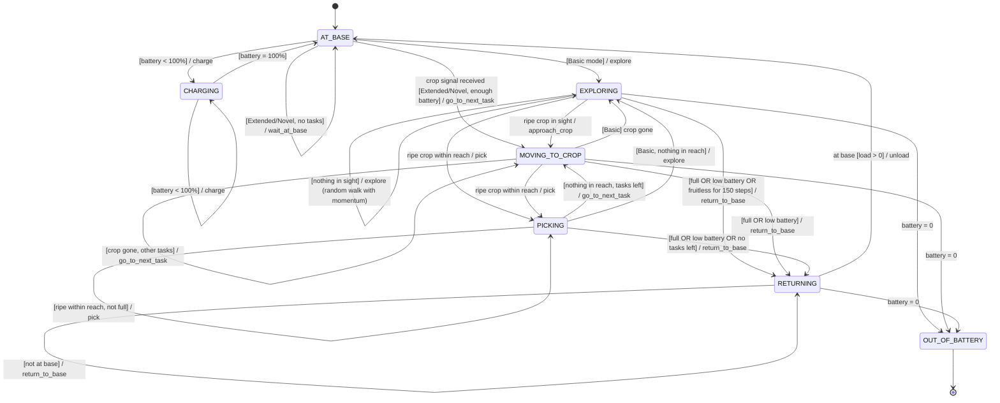
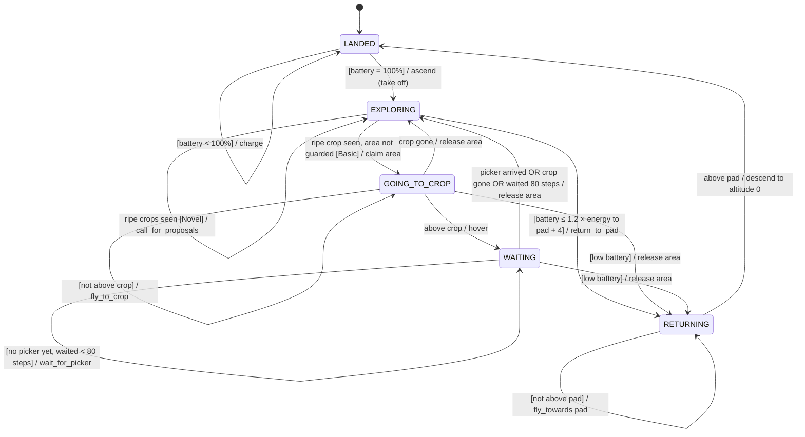
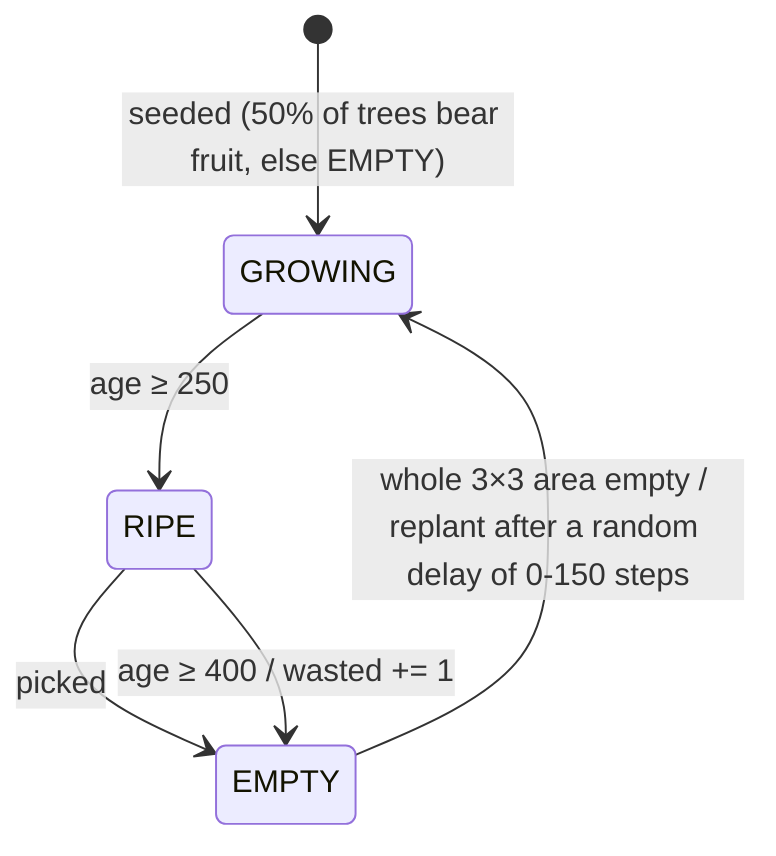
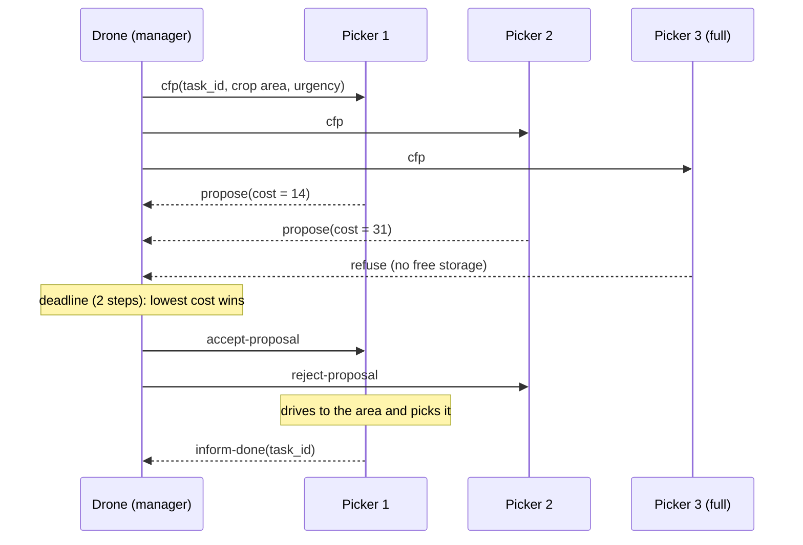

# Design: Robot-Assisted Farming multi-agent system

The diagrams use [Mermaid](https://mermaid.js.org/), which GitHub and VS Code render directly.
State names match the constants in `src/farm/picker.py` and `src/farm/drone.py`. Transition
labels follow the rule format used in the module: **event [condition] / action**. They map onto
the rules in each agent's `make_decision()`, which are checked in priority order.

## 1. Agents and environment

| Element | Mesa class | Scheduled? | Role |
|---|---|---|---|
| Picker robot | `PickerRobot` | yes | autonomous agent: picks, carries and delivers strawberries |
| Explorer drone | `ExplorerDrone` | yes | autonomous agent: finds ripe crops and coordinates pickers |
| Tree | `Tree` | no | holds a crop: `growing → ripe → empty`, aged by the environment |
| River | `Water` | no | passable by pickers, but leaving a water cell takes 2 steps |
| Base / landing pad | `Base` | no | pickers unload and charge at the base; drones land and charge on the pad |
| Lane | `Ground` | no | walkable soil |

Shared infrastructure:
* `FarmMap`: static terrain knowledge and Dijkstra route planning (water costs double).
* `MessageBus`: mailboxes with FIPA-style performatives (`inform-crop`, `cfp`, `propose`,
  `refuse`, `accept-proposal`, `reject-proposal`, `inform-done`).
* `FarmModel`: builds the layout, runs the crop life-cycle and collects the KPIs.

### Hardware capabilities → actions

| Robot | Capability in the brief | Action(s) |
|---|---|---|
| Picker | arm cuts strawberries | `pick` (any ripe tree within Chebyshev distance 2) |
| Picker | stores and carries them | `load` up to `capacity`; `unload` at base |
| Picker | moves on rough terrain, but not through trees | `explore`, `move_to_crop`, `return_to_base` (lanes only) |
| Picker | crosses water, slowly | `step_to` needs 2 steps to leave a water cell |
| Picker | battery | `charge`; every step costs energy |
| Drone | 6 directions | `move_front`, `move_back`, `move_left`, `move_right`, `ascend`, `descend` |
| Drone | flies over trees | may only enter a tree cell above altitude 1 |
| Drone | camera + vision → urgency | `scan` (radius = altitude); `Tree.urgency` ∈ [0, 1] |
| Drone | signals other robots | `report_crops` (extended), `call_for_proposals` / `award_contracts` (novel) |

## 2. Picker robot statechart



**Safety rules, checked first every step:**
* *Low battery* means battery ≤ 1.5 × energy to drive home + 10. Once triggered, the decision is
  **latched** until the robot is fully charged. Without the latch, the threshold falls as the robot
  nears home, and it would turn back to work and ping-pong until the battery is flat.
* Before setting off for a task, the robot checks that the battery covers the round trip
  (go there + come home). If it doesn't, it recharges first.

**Collision avoidance:** only one picker per cell, except on the base. A blocked robot waits, and
every 3 steps tries to plan a way round the obstacle that adds no more than 6 steps. If its route
has not got shorter for 8 steps, it is either deadlocked or dodging another robot back and forth,
so it takes the direct route and squeezes past.

**Opportunistic picking:** in every mode, a ripe crop within reach is picked even when it is not
the current target.

## 3. Explorer drone statechart



In Novel mode the drone also runs `award_contracts()` every step, whatever its state, so auctions
finish even while it is flying home.

## 4. Operation modes

| | Basic | Extended | Novel: Contract Net |
|---|---|---|---|
| Crops age, rot and regrow | no | yes | yes |
| Pickers leave base | immediately, to explore at random | only after a drone signal | only after winning a contract |
| Drone on finding crops | hovers until a picker arrives | `inform-crop` to all pickers (broadcast) or the nearest free picker (direct) | auctions the crop area |
| Task allocation | none | each picker chooses (urgency vs distance) | the drone chooses the lowest bid |
| Simulation ends | all ripe crops delivered | `max_steps` | `max_steps` |

Switch between them in the UI's **Operation mode** drop-down, then press *Reset*. In code, use
`FarmModel(mode=...)`.

### Crop life-cycle (environment, Extended/Novel)



## 5. Novel mode: Contract Net Protocol

Task allocation uses the **Contract Net Protocol** (Smith, 1980), a market-based
cooperation mechanism. Each drone acts as a *manager* and each picker as a potential *contractor*.



**Bid (cost) a picker computes** in `PickerRobot.estimate_cost`:

```
cost = travel steps from its last committed task (or current position) to the crop
     + 10 × number of tasks already committed            (queue penalty)
     + steps to base + charging time                     (if the battery can't cover the job)
     + steps to base                                     (if storage is currently full)
refuse if: no free storage after commitments, out of battery, or the crop is unreachable
```

If nobody bids, the drone re-announces the area 10 steps later. Areas still ripe are re-announced
every 40 steps in case a contractor failed.

**What changes compared with Release 2.0:**
* *Structure:* drones gain a manager role (`pending_cfps`, `award_contracts`). Pickers gain a
  contractor role (`estimate_cost`, `respond_to_cfp`) and keep commitments with task ids. Four
  new performatives are added.
* *Dynamics:* allocation becomes a negotiation. Each crop area goes to exactly one robot, chosen on
  its *whole state* (position, queue, battery, load), instead of every robot hearing about every
  area (broadcast) or a fixed nearest-robot heuristic (direct).

## 6. KPIs

| KPI | Definition | Better |
|---|---|---|
| Harvest rate | picked ÷ (picked + wasted) | higher |
| Energy per strawberry | total robot energy ÷ delivered | lower |
| Mean pick latency | mean steps from ripening to picking | lower |
| Messages sent | transmissions on the bus (a broadcast counts once) | lower |
| Picker utilisation | share of picker-steps spent away from base | context |
| Delivered / Wasted / Ripe on field | counts | - |

See `src/analysis.ipynb` for the results and their critical analysis.

## References

* Smith, R.G. (1980) 'The Contract Net Protocol: high-level communication and control in a
  distributed problem solver', *IEEE Transactions on Computers*, C-29(12), pp. 1104–1113.
* FIPA (2002) *FIPA Contract Net Interaction Protocol Specification* (SC00029H). Foundation for
  Intelligent Physical Agents.
* Wooldridge, M. (2009) *An Introduction to MultiAgent Systems*. 2nd edn. Chichester: Wiley.
* Kazil, J., Masad, D. and Crooks, A. (2020) 'Utilizing Python for agent-based modeling: the Mesa
  framework', in *Social, Cultural, and Behavioral Modeling*. Cham: Springer, pp. 308–317.
